# logic2image

[English](README.md) | **简体中文**

把文章里的逻辑，转化成清晰的解释型配图。

## 示例

两张金融文章配图，分别展示不同的表达方式，直接以 SVG 显示。

### 合约双方

买方支付权利金获得权利，卖方收取权利金并承担被指派时的义务。



### 收益曲线

以一金衡盎司黄金看涨期权为例：行权价 4,150 USD、权利金 50 USD，不计费用。



## 能做什么

- 阅读文章，梳理关键关系，建议适合配图的位置。
- 根据内容选择流程、对比、矩阵或定量图表。
- 绘制前拟定标题、文案、连接关系和数据。
- 制作可编辑 SVG，并渲染 PNG 预览。
- 检查 SVG 结构、文字重叠和可读性，迭代调整图片。

## 使用

将整个目录放在项目的 `.agents/skills/logic2image/` 下。
在兼容的 agent 中调用 `/logic2image`，或让它阅读 [SKILL.md](SKILL.md)。

> 用 logic2image 为这篇文章配图。先给出配图位置、每张图要回答的问题与内容
> 蓝图，等我确认后再画。

如果希望直接推进，明确授权 agent 规划并绘制即可。
只有在你要求时，才替换已有图片。

## 工作流

**理解 → 选图 → 蓝图 → 绘制 → 验证 → 优化**

一图一个重点，不强加层级、不虚构数据，也不固定配图数量。
如果正文或表格已经足够清楚，可以不画。

## 工具

在本目录中，对 agent 已完成的图运行：

```sh
python3 scripts/validate_svg.py figure.svg
python3 scripts/render_svg.py figure.svg --output-dir previews --widths 800 600
```

工具需要 Python 3；渲染另需 Playwright 和 Chrome，精确字体效果需要本机
可用的 Georgia。不会自动安装依赖，也不需要图像生成 API。

内置脚本只能创建**空白绘图框架**，不是自动成品图生成器。
详细步骤见[验证说明](references/validation.md)。
源码检查不能替代内容审查和真实文章页面检查。
创建框架时需明确显示宽度和目标字号，渲染时也需指定检查宽度。
最小字号可通过 `--min-text-px`、`--min-support-px` 调整，默认分别为 12px、11px。

## 目录

| 路径 | 用途 |
|---|---|
| `SKILL.md` | Agent 入口 |
| `references/` | 内容、布局、绘制与排版规则 |
| `assets/` | 完整语义配色 |
| `templates/` | 内容蓝图与 SVG 框架 |
| `scripts/` | 框架生成、源码检查与浏览器渲染 |
| `examples/` | SVG 示例与 PNG 预览 |

## 致谢

- 文章理解部分参考了 [chingswy/Skill-Research-Figure](https://github.com/chingswy/Skill-Research-Figure)。
- SVG 相关配色方案参考了 [canmi21/lib](https://github.com/canmi21/lib)。
