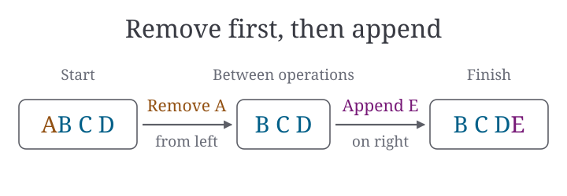
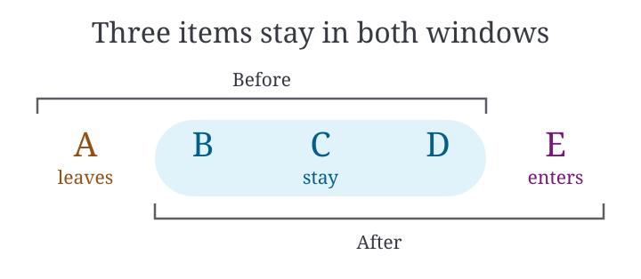

# One sliding-window update, two reader questions

> A window holds four consecutive items. It currently contains A, B, C, D.
> To advance one position, first remove A from the left, then append E on the
> right. The new window is B, C, D, E.

### Which operation comes first?

Use this view beside an implementation walkthrough. Trace the operations in
order. The intermediate state B, C, D shows the window after removal and
before insertion.

### Which items stay in the window?

Use this view when explaining why only the ends change. Locate B, C and D
once and compare the two spans against those same positions. Both spans
cover all three letters. Only the old span covers A, and only the new one
covers E.

Choose the first view when the next operation matters. Choose the second
when the reader needs to see what was retained. A single illustration can
answer either question using the same source passage.
